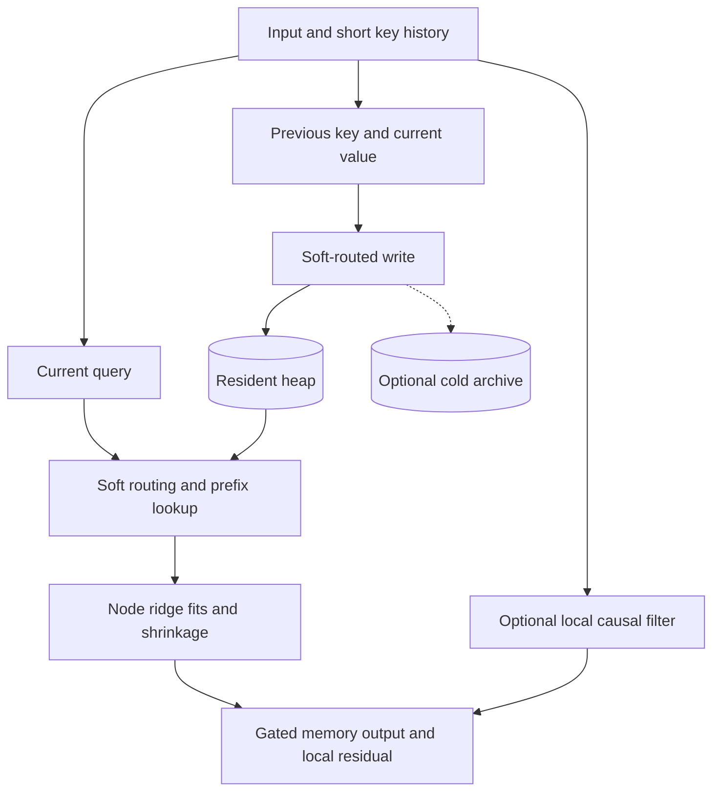
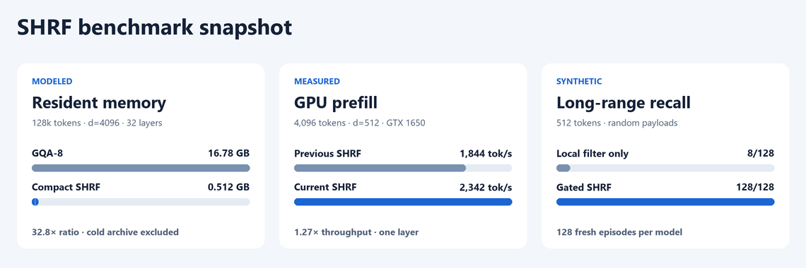

# SHRF — Shrinkage Heap Regression Forest

SHRF is an experimental decoder memory built from small, softly routed ridge regressors.
A previous-token key binds the current token's value. Causal reads aggregate a bounded
beam of heap summaries, with empirical-Bayes shrinkage and an optional nonlinear
residual sketch. The same equations run in parallel PyTorch training and recurrent
inference. The Rust backend implements the full unconsolidated CPU decoder.

- [Formalization](docs/FORMALIZATION.md)
- [Complexity model](docs/COMPLEXITY.md)
- [Contextual addressing, local value path, and accumulation](docs/REVISION.md)
- [Measured results and failure modes](RESULTS.md)
- [Reproduction commands](docs/REPRODUCING.md)
- [Hardening, checkpointing, and decay](docs/HARDENING.md)

## Architecture



A token reads the prefix before its own write becomes visible. Training computes
the prefixes with segmented scans. Consolidation reduces resident sketch
allocations, with indexed recovery from the optional SQLite tape.

## Language model checkpoints

The reasoning decoder has four SHRF layers, a local causal mixer, 469,560
parameters, and a 2,048-token vocabulary with byte fallback. It supports
English and Russian prompts and saves its vocabulary in the checkpoint.

| Checkpoint | Training data | Local output |
|---|---|---|
| Fable 5k | Assistant text from the Fable 5k split | `checkpoints/fable_shrf_text_5k/best.pt` |
| STEM 840 | GSM8K, MBPP, SciQ, Dolly, OpenAssistant, and synthetic exercises | `checkpoints/shrf_curriculum_2/SHRF-STEM-840.pt` |
| Distilled 960 | The STEM mixture plus short samples from five instruction datasets | `checkpoints/shrf_distilled/best.pt` |
| Tensorov RU–EN | Tensorov SFT Core, OpenAssistant, and checked math, logic, and Python exercises | `checkpoints/shrf_tensorov_reasoning_v2/model.pt` |
| Tensorov Math | 300 more steps from Tensorov RU–EN, with additional arithmetic and GSM8K train examples | `checkpoints/shrf_tensorov_math/model.pt` |

The math run's data pool includes 4,429 Tensorov examples, 1,301 OpenAssistant
exchanges, 6,756 synthetic reasoning cases, 1,048 additional bilingual
arithmetic prompts, and 371 eligible GSM8K train examples. Most Tensorov
answers are long enough that training uses a prefix of the answer and
omits its end marker. See the [dataset and training guide](docs/REASONING.md).

```console
python -m experiments.reasoning generate --checkpoint checkpoints/shrf_tensorov_math/model.pt --prompt "Compute 30 / 5."
python -m experiments.reasoning generate --checkpoint checkpoints/shrf_tensorov_math/model.pt --arithmetic checkpoints/shrf_digit_arithmetic/digit_cell.pt --prompt "Solve 7x + 11 = 74. Give a number."
```

The second command uses the optional certified digit module for supported
formats, including single-variable linear equations and simple equal-group
problems. The decoder's learned answer accuracy is measured with that
module disabled.

### Mathematics fine-tuning results

| Held-out evaluation | Tensorov RU–EN | Tensorov Math |
|---|---:|---:|
| Short integer arithmetic | 2/32 | 3/32 |
| Linear equations and equal-group problems | 0/18 | 0/18 |
| GSM8K word problems | 0/24 | 0/24 |
| Logic | 12/18 | 11/18 |
| Simple Python functions | 10/18 | 5/18 |
| English reference answers, bits per UTF-8 byte ↓ | 2.73 | 2.68 |
| Russian reference answers, bits per UTF-8 byte ↓ | 2.62 | 2.51 |

With the digit module enabled, the runtime solved all 50 short arithmetic,
linear equation, and equal-group prompts. The prompts came from the two
structured mathematics rows of the table. The mathematics fine-tune
improved arithmetic by one prompt and reduced pass rates on logic and Python.
The [raw results](results/tensorov_math.json) include the training mixture
and scores by operation.

## Benchmark snapshot



| Experiment | Outcome |
|---|---|
| Modeled state, width 4096, 32 layers, 128k tokens | Compact SHRF uses **0.512 GB** of FP32 resident state versus **16.78 GB** for the FP16 GQA-8 KV cache. The cold archive is separate. |
| GPU prefill, one width-512 layer, 4096 tokens | **2,342 tokens/s** versus **1,844 tokens/s** for the prior SHRF implementation on a GTX 1650. |
| CPU decode, one width-4096 layer | **1.13 ms/token** in Rust and **10.56 ms/token** in PyTorch on an Intel i5-10400F. |
| Random-payload recall, 512 tokens | Gated SHRF recovered **128/128** payloads. The local-only control recovered **8/128**. |
| Rust streaming probe, one million tokens | **2/2** synthetic payloads recovered with distinct filler and fact vocabularies. |

On held-out Python documentation, the gated block and local-only control
scored **2.687 and 2.689 bits per byte** on seed 79. This experiment leaves
the forest's contribution to short-text modeling unresolved. Long natural
documents with competing facts and end-to-end latency against optimized GQA
are open evaluation questions. [Full results](RESULTS.md)

## Quick start

Python 3.10+, PyTorch 2.6+, NumPy. CUDA is optional. The Rust crate has no external
dependencies and can be built for Windows, Linux, or macOS.

```console
python -m pip install -r requirements.txt
python -m pip install pytest
cargo build --release --manifest-path rust/shrf-core/Cargo.toml
cargo test --manifest-path rust/shrf-core/Cargo.toml
python -m pytest -q
python -m experiments.demo
```

The native parity test runs after building the shared library. See
[Reproduction commands](docs/REPRODUCING.md) for the research benchmarks.

### Train a small SHRF language model

Download the [Fable 5k JSONL split](https://huggingface.co/datasets/MoreThought/Fable-5.1-Max-Reasoning-Filtered-10000x/blob/main/5k/train.jsonl).
The trainer initializes a four-layer gated SHRF decoder with a local causal
mixer, samples 256-byte windows, and predicts assistant text. Tool calls and
tool outputs can appear in the input context. Whole traces are deduplicated
and assigned to training or validation before window sampling. Validation
scores fixed 64-byte continuations that do not appear verbatim anywhere in
the rendered training traces.

```console
python -m experiments.fable train --data train.jsonl --output checkpoints/fable --device cuda --steps 300
python -m experiments.fable generate --checkpoint checkpoints/fable/best.pt --device cpu --prompt "Explain binary search."
```

The run saves `best.pt` for generation, `latest.pt` for resuming, and
`metrics.json` with held-out bits per byte. To resume, repeat the training command
with the same data and model configuration, add `--resume`, and raise
`--steps` to the new total number of optimizer steps.

To continue on mathematics, algebra, basic physics, Python, and English and
Russian writing, follow the [instruction training guide](docs/CURRICULUM.md).
The [bilingual reasoning experiment](docs/REASONING.md) adds a reversible
word vocabulary, Tensorov instruction data, and supervised short solutions.

### Use SHRF as a layer

```python
import torch
from shrf import SHRFConfig, SHRFLayer
from shrf.rust_backend import RustSHRF
from shrf.tape import IDTape

layer = SHRFLayer(SHRFConfig(d_model=128, n_trees=2, depth=5,
                             r_key=8, d_value=32, sketch_rank=8))
x = torch.randn(1, 128, 128)
y, state, route_loss = layer(x, return_aux=True)
(y.square().mean() + route_loss).backward()

layer.eval()
with torch.no_grad(), IDTape("sequence.sqlite") as tape:
    state = layer.init_state(1, tape=tape)
    prefill, state = layer(x[:, :-1], state)
    layer.consolidate(state, budget=12)
    next_hidden, state = layer.step(x[:, -1], state)
    recovered_rows = tape.recover_time(1, x.shape[1])

# Requires the compiled Rust library. Each Rust handle is one independent stream.
with RustSHRF(layer) as decoder:
    rust_hidden = decoder.step(x[0, 0])
    rust_suffix = decoder.prefill(x[0, 1:])
```

## Source map

| Path | Contents |
|---|---|
| [shrf/](shrf/) | PyTorch layer, regressors, routing, scans, and archive |
| [rust/shrf-core/](rust/shrf-core/) | Rust recurrent decoder and C ABI |
| [experiments/](experiments/) | Synthetic tasks, language baselines, and benchmarks |
| [results/](results/) | Raw experiment and comparison data |
| [tests/](tests/) | Causality, gradients, archive, and cross-backend checks |

The layer returns [batch, time, d_model] and a mutable per-sequence state. Start
each independent sequence with a fresh state. Read and write weights represent
the current model parameters, so after changing projections or split parameters,
initialize a new state or replay compatible archived inputs. The optional
`write_weight` has shape [batch, time], values in [0, 1], and gates only writes.
Pass an initial `IDTape` to enable consolidation and exact cold recovery. Use a
fresh database for each independent stream or batch and a separate database per
layer. `recover_prediction` runs a local ridge refit over archived observations
from a selected leaf and time interval. Archive I/O is synchronous. The native
decoder runs batch one on CPU with FP64 state and supports the full unconsolidated
sketch, routing, and shrinkage. Its archive, consolidation and autograd use the
PyTorch path.

For the combined decoder use `LlamaSHRFBlock(d, cfg, local_lags=3,
local_rank=32, memory_gate_bias=-3.0)` with `cfg.context_lags=2`.
The block returns a paired state for the forest and local path. The standalone
forest's native backend accepts contextual keys, the powered write gate and
chunked recurrent prefill. Build the current native library before running it.

## Practical starting points

| Parameter | Start with | Sweep |
|---|---:|---:|
| Trees | 2 | 1, 2, 4, 8 |
| Heap depth | 5 at small model scale | 3–12, guided by node occupancy |
| Beam | 2 | 1–4 |
| Key / value width | 8 / 32 | 4–16 / 16–128 |
| Sketch width | 8 | 0, 4, 8, 16 |
| Split temperature | 0.2 | 0.1–0.4 |
| Projected key history | 0 for compatibility | 0–4 |
| Local value path | 3 lags, rank 32 in the combined block | 2–8 lags, rank 16–64 |
| Affine / sketch ridge floor | 0.05 / 0.1 | 0.01–0.3 / 0.03–0.5 |
| BPTT chunk | 64 | 32–256, benchmark peak training memory |

- Preserve causal binding, at least one coarse prediction, and continuous routing
  weights. On the paired synthetic task, the zero-lag ablation measures the
  effect of removing successor binding.
- Tune or disable the residual sketch with held-out dense and nonlinear workloads.
  Each additional feature grows the sketch's quadratic Gram term. Use the
  held-out loss and occupancy sweep to choose the smallest stable size.
- Tune shrinkage where nodes have sparse noisy observations. The variance ratio
  is a heuristic, so log its saturation and compare held-out quality without it.
- Full gradients cross chunk boundaries by default. Set `detach_chunks=True` to
  truncate backpropagation on long training runs. Older moments remain visible
  to the forward pass.
- FP64 chunk coalescing reduces FP32 update loss during prefill. Choose FP64
  recurrent state if a mature node must preserve very small per-token writes.
- Use the local-only decoder as a baseline. Short held-out text can reward the
  local filter strongly, and synthetic long recall tests a distinct capability.
  The exponent on the write gate remains 1 by default.
- Enable the tape when exact historical observations matter. Disk growth,
  database I/O, and retrieval policy then belong in latency and footprint budgets.

## Language-model scale-up

1. The runnable two-layer experiment trains on Python documentation with a
   topic-level holdout. Scale it to a larger multi-document corpus with the same
   tokenizer, width, layer count, training tokens and optimizer across GQA,
   local-only and local+SHRF.
2. Train at 2–4k context. Measure next-token perplexity, rare-span copy accuracy,
   and evidence retrieval versus distractor load. Compare held-out books and
   repository-level code at 8k, 32k, and 128k where affordable. Compare both at
   equal model size and equal pretraining compute.
3. Track per-layer occupancy, tree diversity, gate distributions, split entropy,
   early-token gradient norms, and latency at batch 1 and throughput at batch 8.
   Compare frozen random splits, residual calibration, and learned splits.
4. Measure cold recovery under explicit time/leaf hints and measure hot recall
   separately. Compare genuine rare-fact retrieval with a short convolutional
   front-end, learned read/write offsets, and small exact-gradient chunks.

The largest unknowns are language modeling quality, useful tree capacity under
distribution shift, and GPU kernel efficiency. Repeated hard-to-distinguish payloads
can saturate the local fits. Rank collapse removes information before the memory
sees it. The tape can reconstruct recorded projected observations after eviction
when the caller has a suitable index hint. Training or benchmarking 32-layer
4096-wide Transformer checkpoints, GPU fusion, and application-level cold
retrieval policies are future work.
